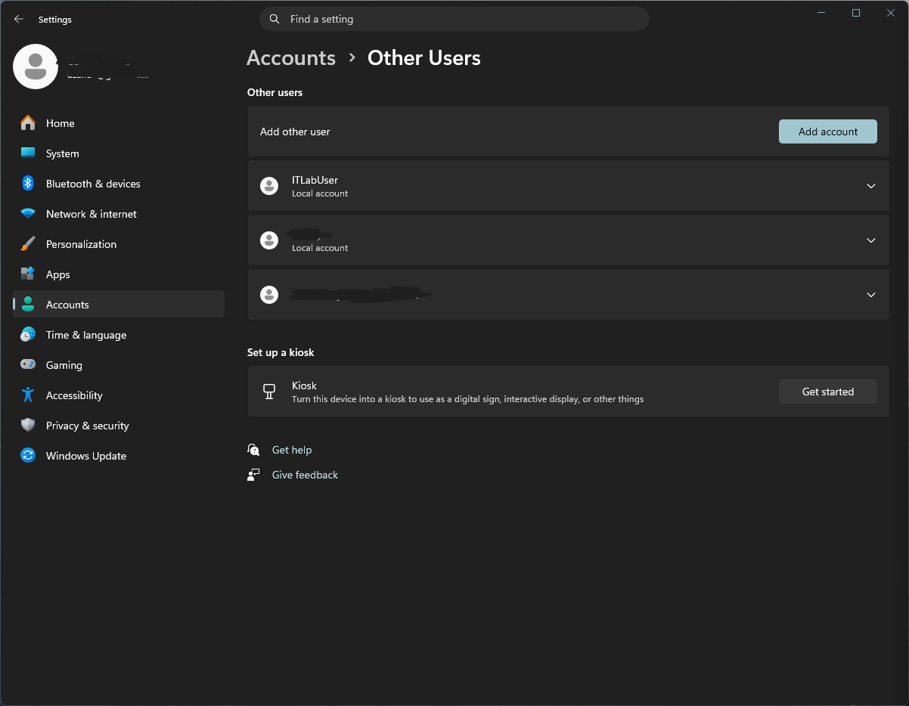
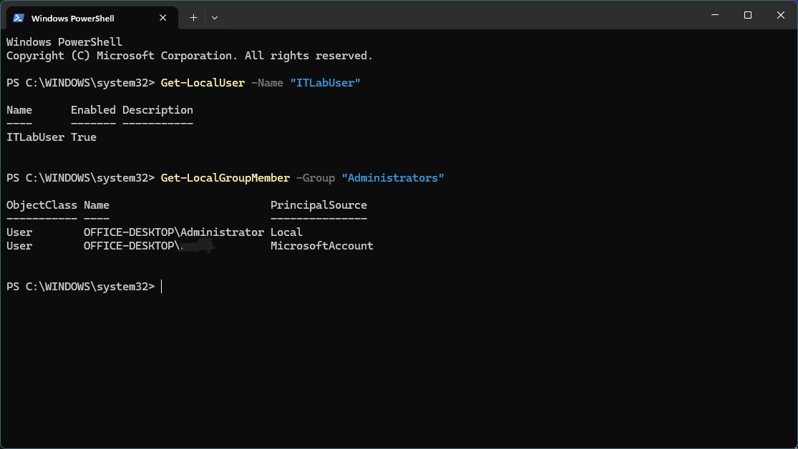
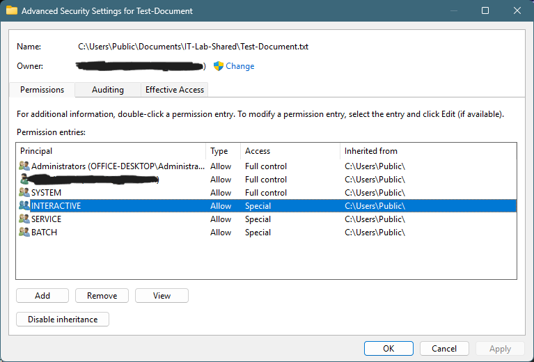
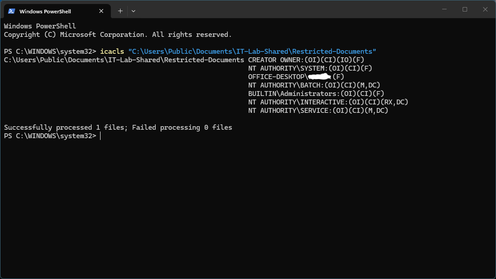
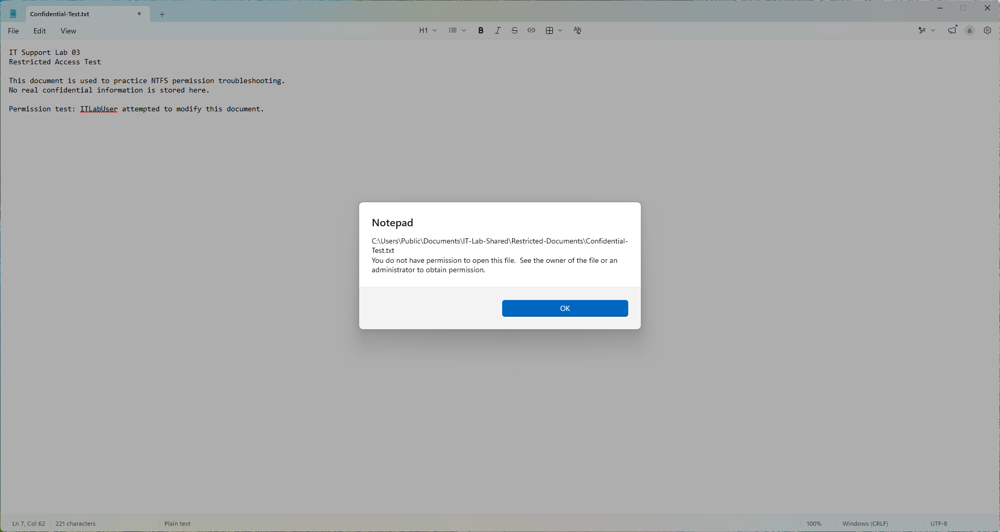
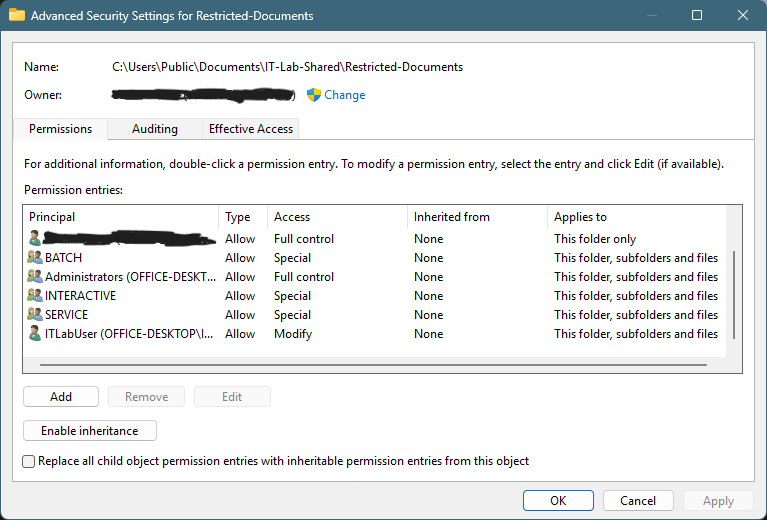
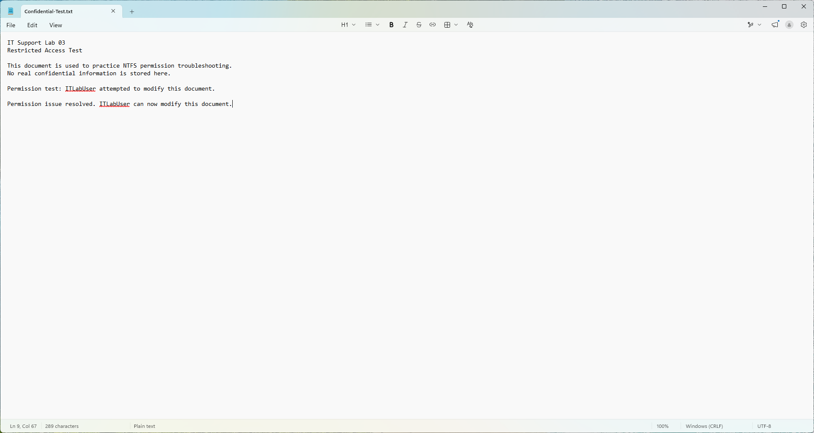

# Lab 03 — Windows NTFS Permissions Troubleshooting

## Overview

In this lab, I simulated and resolved a Windows file access issue involving a standard local user account. The user could open a test document but encountered a permissions error when attempting to save changes.

I investigated Windows account privileges, NTFS permissions, permission inheritance, and access control lists (ACLs). I then applied a targeted permission change and verified that the user could successfully modify the document.

## Lab Environment

- **Operating System:** Windows 11
- **Test Account:** ITLabUser (Standard User)
- **Tools:** Windows Settings, File Explorer, PowerShell, `icacls`, Notepad
- **Test Location:** `C:\Users\Public\Documents\IT-Lab-Shared\Restricted-Documents`

All testing was performed using temporary files and a dedicated test account.

## Objectives

1. Create and verify a standard Windows user account.
2. Examine NTFS permissions and inheritance.
3. Investigate permissions using PowerShell.
4. Reproduce a file access error.
5. Apply a targeted permission correction.
6. Verify that the correction resolves the issue.

## Troubleshooting Process

### 1. Created and Verified a Standard User

Created a local account named `ITLabUser` through Windows Settings.

Used PowerShell to verify that the account was enabled:

```powershell
Get-LocalUser -Name "ITLabUser"
```

Checked the local Administrators group:

```powershell
Get-LocalGroupMember -Group "Administrators"
```

Confirmed that the test account was enabled and was not a member of the Administrators group.





### 2. Investigated NTFS Permissions

Created a test folder and document under Public Documents.

Examined the Security and Advanced Security Settings windows to understand the existing access permissions.

Identified inherited permissions and reviewed entries for SYSTEM, Administrators, INTERACTIVE, and other Windows security principals.




### 3. Configured a Restricted Test Folder

Created a separate `Restricted-Documents` folder containing `Confidential-Test.txt`.

Disabled permission inheritance on this test folder, converting inherited permissions into explicit permissions.

Adjusted the INTERACTIVE permission entry to remove general Write and Modify access while retaining read-related permissions.


### 4. Inspected Permissions Using the Command Line

Ran the following command:

```powershell
icacls "C:\Users\Public\Documents\IT-Lab-Shared\Restricted-Documents"
```

Reviewed the access control list, including permission codes such as:

- `(F)` — Full control
- `(M)` — Modify
- `(RX)` — Read and execute
- `(OI)` — Object inheritance
- `(CI)` — Container inheritance

This provided a command-line view of the folder's configured permissions.



### 5. Reproduced the Problem

Signed in as `ITLabUser` and opened the test document.

The account could initially read the document, but attempting to save changes resulted in a Notepad permission error.

This reproduced a realistic file access issue.



### 6. Applied a Targeted Permission Fix

Returned to the administrator account and opened Advanced Security Settings for `Restricted-Documents`.

Added an explicit **Allow — Modify** permission entry for `ITLabUser`, applying to the folder, subfolders, and files.

This provided the test account with the required access without granting administrator privileges.



### 7. Verified the Resolution

Signed back into `ITLabUser`.

Successfully edited and saved `Confidential-Test.txt`, then reopened the file to confirm the changes persisted.

**Result: The file access issue was resolved.**



## Key Lessons Learned

- NTFS permissions control access to Windows files and folders.
- Standard user accounts can be granted specific access without administrator privileges.
- Inherited permissions originate from parent folders.
- The `icacls` utility provides a useful command-line view of access control lists.
- Allow and Deny permissions behave differently.
- Troubleshooting should include reproducing the problem, investigating its cause, applying a targeted fix, and verifying the result.
- Screenshots and documentation provide evidence of troubleshooting work.

## Conclusion

This lab strengthened my understanding of Windows local accounts, NTFS permissions, and practical access troubleshooting.

By reproducing a file access issue and resolving it through a targeted permission change, I practiced a common desktop support responsibility: helping users regain appropriate access while maintaining account security.
